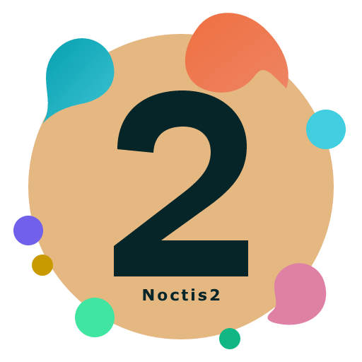

<p align="center">
  <a href="images/noctis2.svg">
    
  </a>
</p>

# Noctis2

An independent fork of [Noctis](https://github.com/liviuschera/noctis). Thank you to **Liviu Schera and the upstream contributors** for the original themes, palettes and artwork that make this fork possible.

Noctis2 preserves all 11 palettes and adds semantic highlighting, Typst/Julia refinements and a TypeScript theme generator. It is not an official Noctis release.

- **Dark:** Noctis2, Azureus, Bordo, Obscuro, Sereno, Uva, Minimus and Viola.
- **Light:** Lux, Hibernus and Lilac.

## Installation

Requires VS Code **1.81 or later**. Extension ID: `atreyu-94.noctis2`.

1. Download a VSIX from a successful [validation workflow](https://github.com/Atreyu-94/Noctis2/actions) while its artifact remains available, or build one below.
2. Run **Extensions: Install from VSIX...** in VS Code and select the file. Use an isolated profile for evaluation.
3. Run **Preferences: Color Theme** and choose a **Noctis2** theme.

Noctis2 can coexist with the original Noctis extension.

## Language support

The theme has no mandatory language-extension dependencies. Language extensions provide grammars and semantic tokens; Noctis2 supplies their colors.

For Typst, use [Tinymist](https://marketplace.visualstudio.com/items?itemName=myriad-dreamin.tinymist); for Julia, use the [Julia extension](https://marketplace.visualstudio.com/items?itemName=julialang.language-julia). Checked versions: Tinymist **0.15.10**, Julia extension **1.249.2** and Julia **1.13.0**.

Checks cover Typst, Julia, TypeScript, Python, JSON and Markdown. Julia used TextMate highlighting in the tested setup; standalone Typst Code Mode has grammar limits for emphasis. Python web checks used Pylance partial mode; JSON and Markdown checks used TextMate.

## Validation and limits

Windows/Linux CI and remote VSIX packaging passed. Local CLI installation and coexistence with Noctis **10.43.3** passed on VS Code **1.143.1**. Visual checks covered all 11 palettes in VS Code Web **1.142.0**, with advanced UI checks limited to Noctis2 and Lilac.

Some syntax and UI colors have low contrast, especially in light variants and the status bar during debugging. These checks do not establish full desktop UI coverage, every language/provider combination or accessibility contrast compliance. Inline/chat checks used local test providers, not remote services.

## Build from source

With Node.js and npm installed, run from the repository root:

```sh
npm ci --ignore-scripts
npm run check
npm run build
npm run audit:compatibility -- --strict
npm run package:vsix -- --out noctis2.vsix
```

Edit `src/` and rebuild to regenerate `themes/`. See [CHANGELOG.md](CHANGELOG.md) for changes.

## Publishing releases

Publishing a stable GitHub release in `Atreyu-94/Noctis2` triggers `.github/workflows/publish.yml`.
The tag must be `vX.Y.Z`, match `package.json`, and point to a commit already merged into `master` with successful validation CI.
Attach that CI run's exact VSIX as `noctis2-X.Y.Z.vsix` and its unchanged `vsix-report.json` to the draft release **before** publishing it.
The workflow compares both attachments against the CI artifacts, verifies SHA-256 and inspects the package against the tagged sources. It does not rebuild the VSIX.
CI artifacts must still be available (currently 14 days); an expired or missing artifact stops publication.

Marketplace uses Trusted Publishing for owner `Atreyu-94`, repository `Noctis2`, workflow `publish.yml`, with no environment. No PAT is required.
Open VSX stays disabled unless the repository variable `OPENVSX_PUBLISH_ENABLED` is exactly `true`.
Enable it only after namespace ownership is verified and an Open VSX trusted publisher for `atreyu-94.noctis2` authorizes the same repository and workflow, without an environment.

For verification or recovery, run **Publish verified release** manually on `master` with the existing release tag.
The default only verifies the attachments; select `publish` to publish them. Both destinations use the same verified artifact and skip an already-published version on retries.
They run independently, so a failure in one registry does not prevent the other from publishing. Re-run failed jobs after resolving the cause.
GitHub releases created by another workflow using `GITHUB_TOKEN` do not trigger this release workflow; use its explicit dispatch in that automation instead.

## AI assistance

AI tools have assisted with code, documentation and validation work in this fork. The maintainer makes every effort to keep it working correctly, but errors may remain. The software is provided "as is", without warranty, under the MIT license; users are responsible for assessing its suitability and use it at their own risk. This disclosure applies only to Noctis2, not the original Noctis project.

## License and credits

[MIT](LICENSE.md), retaining **Copyright (c) 2018 Liviu Schera** and the original license terms. Original artwork is retained; the Noctis2 icon adapts its palette and orbital motif with a distinctive 2. See the [upstream project](https://github.com/liviuschera/noctis) for its contributors and history.
