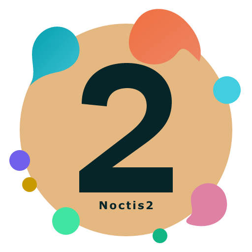

<p align="center">
  <a href="images/noctis2.svg">
    
  </a>
</p>

# Noctis2

An independent fork of [Noctis](https://github.com/liviuschera/noctis). Thank you to **Liviu Schera and the upstream contributors** for the original themes, palettes and artwork that make this fork possible.

Noctis2 preserves all 11 palettes and adds semantic highlighting, Typst/Julia refinements and a TypeScript theme generator. It is not an official Noctis release.

- **Dark:** Noctis2, Azureus, Bordo, Obscuro, Sereno, Uva, Minimus and Viola.
- **Light:** Lux, Hibernus and Lilac.

## Installation

Requires VS Code **1.81 or later**. Extension ID: `atreyu-94.noctis2`.

1. Download a VSIX from a successful [validation workflow](https://github.com/Atreyu-94/Noctis2/actions) while its artifact remains available, or build one below.
2. Run **Extensions: Install from VSIX...** in VS Code and select the file. Use an isolated profile for evaluation.
3. Run **Preferences: Color Theme** and choose a **Noctis2** theme.

Noctis2 can coexist with the original Noctis extension.

## Language support

The theme has no mandatory language-extension dependencies. Language extensions provide grammars and semantic tokens; Noctis2 supplies their colors.

For Typst, use [Tinymist](https://marketplace.visualstudio.com/items?itemName=myriad-dreamin.tinymist); for Julia, use the [Julia extension](https://marketplace.visualstudio.com/items?itemName=julialang.language-julia). Checked versions: Tinymist **0.15.10**, Julia extension **1.249.2** and Julia **1.13.0**.

Noctis2 retains the original 19 TextMate rules and 550 distinct selectors in all eleven variants. The compatibility suite covers all 61 language/dialect cases declared by [Noctis 10.43.3](https://github.com/liviuschera/noctis/tree/4a82370b2c064e36726c23e94f27ed3782bd6ecd): it compares the original and current themes using real, pinned TextMate grammars and shared samples. See the [sample catalogue and test commands](../../tests/samples/README.md).

The expanded matrix checks TextMate colors and styles, not every language server or visual rendering. Noctis2 enables semantic highlighting, so a provider can intentionally produce colors different from the original TextMate-only theme. Optional embedded grammar gaps are recorded in the test report. Provider-specific checks separately cover Typst, Julia, TypeScript, TSX, Python, JSON, Markdown and Lua. Julia used TextMate highlighting in the tested setup; standalone Typst Code Mode has grammar limits for emphasis. Python web checks used Pylance partial mode.

## Validation and limits

Windows/Linux CI and remote VSIX packaging passed. Local CLI installation and coexistence with Noctis **10.43.3** passed on VS Code **1.143.1**. Visual checks covered all 11 palettes in VS Code Web **1.142.0**, with advanced UI checks limited to Noctis2 and Lilac.

Some syntax and UI colors have low contrast, especially in light variants and the status bar during debugging. These checks do not establish full desktop UI coverage, every language/provider combination or accessibility contrast compliance. Inline/chat checks used local test providers, not remote services.

## Build from source

With Node.js and npm installed, run from the repository root:

```sh
npm ci --ignore-scripts
# Tests also require Neovim on PATH (or the NVIM environment variable).
npm run check
npm run build
npm run audit:compatibility -- --strict
npm run package:vsix -- --out noctis2.vsix
```

Edit `core/src/` for shared colors or `ports/vscode/src/` for VS Code mappings, then rebuild to regenerate `ports/vscode/themes/`. See [CHANGELOG.md](CHANGELOG.md) for changes.

## Publishing releases

Update `ports/vscode/package.json` and its dated `ports/vscode/CHANGELOG.md` entry, then merge the version commit into `master`.
Push a stable tag `vX.Y.Z` pointing to that commit in `Atreyu-94/Noctis2`; it must match the package version.
The **Create release from verified tag** workflow waits up to 15 minutes for that commit's successful master CI, downloads its exact VSIX and report, and validates the hash and packaged contents against the tagged sources.
It creates a draft release with `noctis2-X.Y.Z.vsix`, `vsix-report.json` and notes from the changelog, downloads and checks the attachments, and publishes the release.
It then dispatches **Publish verified release**, which repeats the checks before sending the same VSIX to the galleries. Neither workflow rebuilds the package.
GitHub's `GITHUB_TOKEN` is sufficient; the explicit dispatch handles GitHub's suppression of release events created by that token.
CI artifacts must still be available (currently 14 days); expired/missing artifacts, failed CI, version mismatches or tags outside `master` stop the process.
Push tags using your Git client or another identity that triggers Actions; tags created by a workflow with `GITHUB_TOKEN` require explicitly dispatching the creation workflow.

Marketplace uses Trusted Publishing for owner `Atreyu-94`, repository `Noctis2`, workflow `publish.yml`, with no environment. No PAT is required.
Open VSX stays disabled unless the repository variable `OPENVSX_PUBLISH_ENABLED` is exactly `true`.
Enable it only after namespace ownership is verified and an Open VSX trusted publisher for `atreyu-94.noctis2` authorizes the same repository and workflow, without an environment.

For a read-only rehearsal, run **Create release from verified tag** manually on `master` with an existing stable tag; its default prepares downloadable files without creating a release or publishing.
Select `create` to resume the full flow. Retries can complete missing attachments in a draft; existing attachments are never overwritten, and an existing published release must already contain the matching files.
No tags or published history are rewritten. Release creation and gallery publishing have separate workflow results: a created release is not proof that a gallery accepted it.

For gallery verification or recovery, run **Publish verified release** manually on `master` with the existing release tag.
The default only verifies the attachments; select `publish` to publish them. Both destinations use the same verified artifact and skip an already-published version on retries.
They run independently, so a failure in one registry does not prevent the other from publishing. Re-run failed jobs after resolving the cause.
Publishing a release manually also triggers **Publish verified release**; in that case attach the exact CI VSIX and report before publishing the draft.

## AI assistance

AI tools have assisted with code, documentation and validation work in this fork. The maintainer makes every effort to keep it working correctly, but errors may remain. The software is provided "as is", without warranty, under the MIT license; users are responsible for assessing its suitability and use it at their own risk. This disclosure applies only to Noctis2, not the original Noctis project.

## License and credits

[MIT](LICENSE.md), retaining **Copyright (c) 2018 Liviu Schera** and the original license terms. Original artwork is retained; the Noctis2 icon adapts its palette and orbital motif with a distinctive 2. See the [upstream project](https://github.com/liviuschera/noctis) for its contributors and history.
